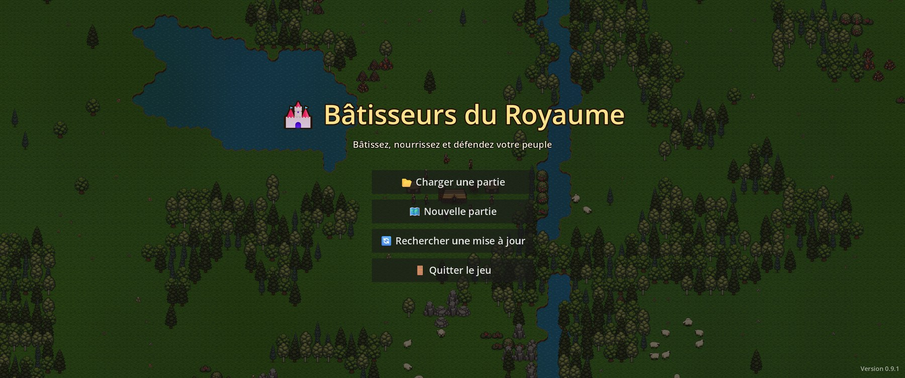
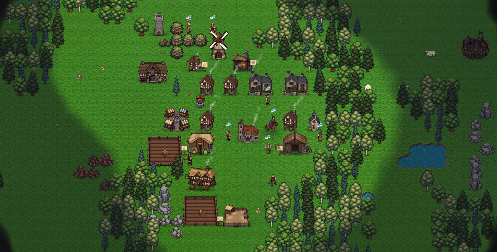
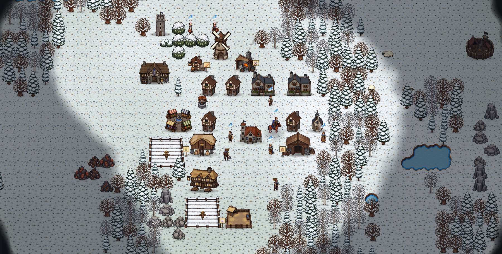
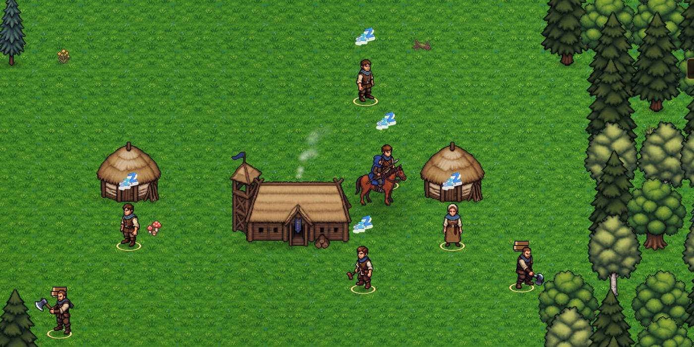
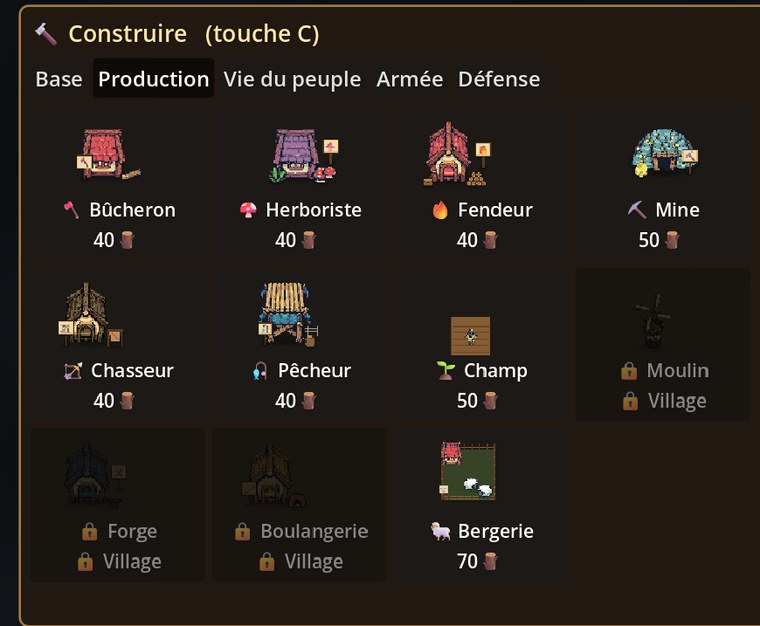
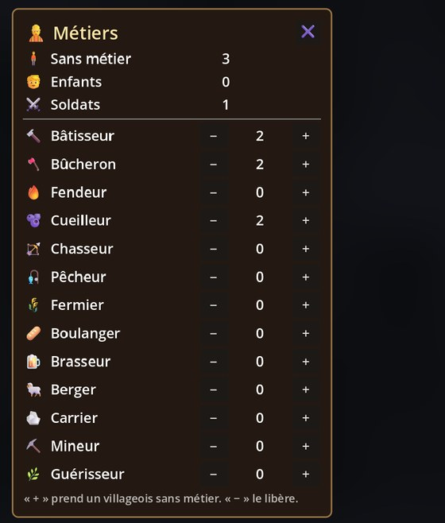

# 🏰 Bâtisseurs du Royaume

**Un jeu de gestion et de stratégie médiéval pour Windows, en français.**
Fondez un village, nourrissez et protégez votre peuple au fil des saisons, faites-le grandir de la clairière à la cité fortifiée, et défendez-le face aux bandits, aux loups et aux royaumes rivaux.

Inspiré des grands jeux de gestion comme *Banished* (la survie du village, les saisons, les familles) et *Age of Empires* (les âges, l'armée, les royaumes ennemis).

> 🆕 **Version 0.9.1** : tous les graphismes ont été refaits (villageois animés, bâtiments, nature qui change avec les saisons…), villageois inactifs, démolition, barres de vie des bâtiments. [Voir les nouveautés](https://github.com/te2dyn/batisseurs-du-royaume-versions/releases/latest).

### [⬇️ Télécharger la dernière version](https://github.com/te2dyn/batisseurs-du-royaume-versions/releases/latest)

---

## 📸 Aperçu

| Construire | Métiers |
|:---:|:---:|
|  |  |

---

## 🌾 Le jeu

### Un village vivant
- **Des graphismes originaux en pixel art** : chaque métier a son personnage, animé quand il marche et quand il travaille (le bûcheron coupe, le mineur pioche, le pêcheur lance sa ligne…).
- **18 métiers** : bûcheron, cueilleur, chasseur, pêcheur, fermier, boulanger, brasseur, berger, carrier, mineur, guérisseur, bâtisseur…
- **34 bâtiments**, chacun avec son allure, qui change à chaque âge. Les chantiers montent avec leurs échafaudages ; un bâtiment détruit laisse des ruines.
- Un bouton **💤 villageois inactifs** retrouve ceux qui n'ont rien à faire. On peut **démolir** un bâtiment (la moitié du coût est rendue) ou **annuler** un chantier.
- Les villageois **mangent, ont froid, tombent malades, vieillissent** et fondent des familles : les enfants deviennent adultes au bout d'un an.
- **Le bonheur** dépend de la variété des repas, du logement, de la taverne, de la chapelle, des impôts… Un peuple malheureux fait grève ou s'en va.

### Les saisons
- **Printemps, été, automne, hiver**, chacune avec ses couleurs, sa météo (pluie, orage, brouillard, neige) et ses règles. Les feuillus roussissent en automne, la neige recouvre tout l'hiver et les lacs gèlent.
- On sème au printemps, on récolte à l'automne. L'hiver, les maisons brûlent des bûches et les loups rôdent.

### Les âges et le progrès
- **4 âges** à traverser, de la clairière au royaume.
- **33 technologies** : agriculture, artisanat, armée, défense…
- **Marché** pour acheter et vendre, **impôts** à régler (un clic sur l'or).

### La guerre
- **15 sortes de soldats** : lanciers, archers, cavaliers, machines de siège…
- **Tours, murailles, portes** et alarme pour abriter les villageois. Une barre de vie apparaît sur les bâtiments attaqués ; les bâtisseurs viennent les réparer.
- **Repaires de bandits**, meutes de loups en hiver, **royaumes rivaux** qui grandissent et envoient leurs armées.

### Diplomatie et imprévus
- Cadeaux, tributs, trêves, échanges, **alliances**… ou guerre ouverte avec les royaumes voisins.
- **Événements** : épidémies, incendies, hiver rude, marchands, fêtes, voyageurs qui demandent asile…
- Une **chronique** raconte l'histoire de votre village.

### Une partie à votre façon
- **Modes** : Survie, Bataille ou mixte.
- **Population** : naissances (familles) ou formation au centre-ville.
- Nombre de rivaux, difficulté, taille de la carte, ressources de départ, conditions de victoire (conquête, merveille, 100 habitants, 5 hivers…).
- **Sauvegardes** : 5 emplacements plus une sauvegarde automatique à chaque saison.

---

## 💾 Installation

1. Téléchargez **`Installer-Batisseurs-du-Royaume-<version>.exe`** sur la [page des versions](https://github.com/te2dyn/batisseurs-du-royaume-versions/releases/latest).
2. Double-cliquez dessus.
   > ⚠️ Windows peut afficher **« Windows a protégé votre ordinateur »**, parce que le jeu n'est pas signé numériquement (une signature est payante). Cliquez sur **« Informations complémentaires »**, puis **« Exécuter quand même »**.
3. Choisissez si vous voulez un raccourci sur le bureau, puis installez. Pas besoin de droits d'administrateur.

**Configuration** : Windows 10 ou 11, 64 bits. Une carte graphique simple suffit. Environ 150 Mo d'espace disque.

## 🔄 Mises à jour

Dans le menu du jeu, cliquez sur **« 🔄 Rechercher une mise à jour »**. Si une nouvelle version existe, le jeu montre ses nouveautés et propose de l'installer en un clic. **Vos sauvegardes sont gardées.**

Le jeu ne se connecte à internet **que** lorsque vous cliquez sur ce bouton.

## 🎮 Commandes

| Action | Commande |
|---|---|
| Choisir une unité / un bâtiment | Clic gauche |
| Choisir plusieurs unités | Glisser un rectangle, ou Maj + clic |
| Toutes les unités du même métier à l'écran | Double-clic |
| Aller, récolter, construire, attaquer | Clic droit |
| Marche d'attaque (soldats) | Maj + clic droit |
| Déplacer la vue | ZQSD ou flèches, souris au bord de l'écran, clic molette + glisser, mini-carte |
| Zoomer | Molette |
| Revenir au centre-ville | H |
| Villageois inactif suivant | I |
| Construire / Progrès / Diplomatie / Options | C / T / P / O |
| Alarme | B |
| Créer un groupe / le choisir | Ctrl + chiffre / chiffre (deux fois : centrer la vue) |
| Pause | Espace |
| Menu (sauvegarder, charger) | Échap |
| Plein écran | F11 |
| Code secret | Entrée |

Astuces : un clic sur 👥 dans la barre du haut ouvre le tableau des métiers ; un clic sur 🪙 règle les impôts ; l'éclaireur peut explorer la carte tout seul. Les boutons en haut à droite (🤝 🔔 📜 ⚙️) donnent leur nom au survol de la souris.

## 📁 Où sont mes sauvegardes ?

Dans `%APPDATA%\Godot\app_userdata\Bâtisseurs du Royaume\saves`. Elles ne sont effacées ni par une mise à jour, ni par la désinstallation.

---

## 🙏 Crédits

- **Images** : graphismes originaux créés pour le jeu avec [PixelLab](https://www.pixellab.ai). Les toutes premières versions utilisaient le pack « Tiny Swords » de [Pixel Frog](https://pixelfrog-assets.itch.io/tiny-swords), dont quelques images restent dans le jeu comme images de secours.
- **Musiques** : RandomMind ([OpenGameArt.org](https://opengameart.org)), licence CC0.
- **Sons** : [Kenney](https://kenney.nl) (Impact Sounds, RPG Audio, Interface Sounds), ambiances d'OpenGameArt.org, licence CC0. Pluie, feu, cloche, loups et quelques autres sons sont fabriqués par le jeu lui-même.
- **Moteur** : [Godot Engine](https://godotengine.org) 4.

Ce dépôt ne contient que les versions installables du jeu.
